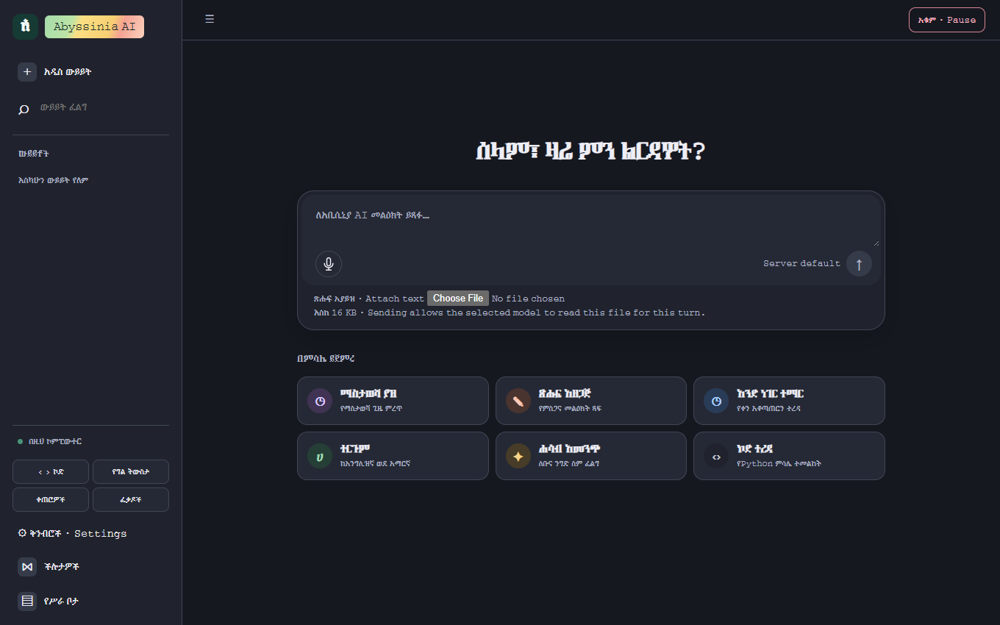

# Abyssinia AI · አቢሲኒያ AI

An Amharic-first assistant by **AK ETHIO AI**. Use everyday Amharic, English, or both in one conversation. Choose the model that answers you.

[Download and onboarding page](https://kassahunalazar.github.io/amharic-hermes/)

## Choose your edition

| | Windows x64 | Android 8.0 and newer |
| --- | --- | --- |
| Download | [Windows setup EXE](https://github.com/kassahunalazar/amharic-hermes/releases/download/v0.1.0/Abyssinia-AI-Setup.exe) | [Signed Android APK](https://github.com/kassahunalazar/amharic-hermes/releases/download/v0.1.0/Abyssinia-AI.apk) |
| Where it runs | A local Hermes gateway opens in your browser | A native app on your phone |
| Model connection | Named provider presets, local models, OmniRoute or a custom endpoint | Your OpenAI-compatible Chat Completions endpoint and model |
| Conversation | Amharic chat, attachments and microphone dictation with installed weights | Amharic chat and editable dictation where the phone's speech recognizer supports Amharic |
| Workspace | Approved file edits, coding, Windows controls, memory, reminders and scoped MCP tools | Local chat history and provider settings |

## First conversation on Windows

1. Download and run **Abyssinia-AI-Setup.exe** as your usual Windows user. Accept the installation prompt. File Explorer opens the installed folder.
2. Run **Setup Abyssinia Engine.cmd** once. This step downloads the pinned Hermes engine and requires internet access.
3. Run **Open Abyssinia AI.cmd** and keep its window open. The assistant opens on your PC at **127.0.0.1:8789**.
4. In **ቅንብሮች · Settings**, select a provider and model. Set the provider key in the backend configuration if required. Test the connection, save, and start a chat.

## First conversation on Android

1. Download **Abyssinia-AI.apk** on your phone. Open the file and follow Android’s installation prompts.
2. Open **Abyssinia AI → ቅንብሮች**. Enter the HTTPS base URL, exact model ID, and API key for your provider. For example, the default URL targets OpenRouter. Choose a model available to your account.
3. Tap **Save**, enter **ሰላም፣ ዛሬ ምን ልርዳዎት?**, and tap **ላክ**. The app connects directly to your provider. A Windows PC is unnecessary.
4. The phone stores the latest 40 messages in its private app storage. Changing the endpoint or model starts a new history. The key lasts for the current app session. Clear Android app storage to erase the conversation and settings.

Both editions send chat messages to the model endpoint you select. Provider charges and availability depend on your account. On Android, dictation is handled by the speech service installed on the phone.

## Explore and build

- [Windows workspace guide](guides/windows.md)
- [Architecture](ARCHITECTURE.md) · [Security](SECURITY.md) · [Test evidence](TEST_EVIDENCE.md)
- [Build the Windows and Android downloads](guides/build.md)
- [Third-party notices](THIRD_PARTY_NOTICES.md)

Maintained by **AK ETHIO AI**. [Official business website](https://akethioai.netlify.app/)
